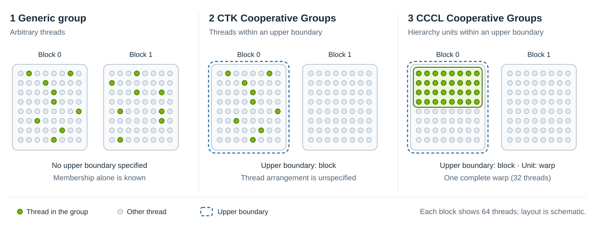

.. _cudax-coop-group:

CCCL Cooperative Groups
=======================

.. toctree::
  :hidden:
  :maxdepth: 1

  mapping/index
  synchronizer/index
  coalesced_group
  generic_group
  group_view
  this_group
  virtual_group

CCCL Cooperative Groups are available through the ``<cuda/experimental/coop/group>`` header.

Concerning Groups
-----------------

Let's start with a quick introduction to groups regarding the CUDA programming model. A group could be simply defined as a collection of threads that can synchronize, thus can cooperate on solving an algorithmic problems. However, such a generic group isn't too suitable for the CUDA programming model, because the definition doesn't allow an efficient implementation of the synchronization in the hardware.

CTK's Cooperative Groups solve this issue by adding an upper boundary within which the threads are grouped to the definition. It means that you can't simply group arbitrary threads, but you can only group threads within a given CUDA hierarchy level. This information is used by the implementation to select the right synchronization mechanism for a given group.

Even though this design solves the synchronization efficiency issue, the design could be improved even further. When writing a collective algorithm, often you can do an operation more efficiently when you know how the threads are actually grouped within the upper boundary. For example, when you have a group of threads within a block and you know that the threads always form a full warp, you could use this information to implement the algorithm more efficiently. However, CTK's Cooperative Groups don't store this information inside the group.

CCCL Cooperative Groups address this problem by changing the group definition again. In this new design, a group is a collection of units within an upper boundary that can synchronize, where the unit can be any CUDA hierarchy level below or same as the upper boundary. This means that when writing a cooperative algorithm, you what is the biggest building block of the group and optimize the algorithm accordingly.

   Group definitions illustrated with two CUDA thread blocks. Green dots are
   participating threads; dashed blue outlines mark the upper boundary. The CCCL
   example additionally identifies a complete warp as the group's unit.

Hierarchy-Aware Groups
----------------------

One of the limitations of the CTK's Cooperative Groups design is that they lack static information about the hierarchy of the launched kernel. For instance, with the CTK's Cooperative Groups, a computation of 1D thread rank within a block is always done as:

.. code:: cpp

  const auto thread_rank = (threadIdx.z + blockDim.y * threadIdx.y) * blockDim.x + threadIdx.x;

independently on whether the thread block is 1D or 3D. If the thread block is actually 1D, this computation wastes precious registers and introduces unnecessary overhead.

CCCL Cooperative Groups on the other hand are hierarchy-aware. They are designed to interoperate with the ``cuda::launch`` to get as much compile-time information about the launched kernel as possible. If the launched hierarchy really consists of 1D blocks, then CCCL Cooperative Groups would compute only:

.. code:: cpp

  const auto thread_rank = threadIdx.x;

which can make the difference between register spilling to local memory and fitting everything within registers.

Having the knowledge about the statically-known information about the launched hierarchy has another great benefit. An API taking a group can statically allocate resources such as shared memory precisely for the given group without the need for passing this information separately via a template parameter. This is a property that is very valuable for cooperative algorithms.

Separation of Partition and Synchronization
-------------------------------------------

When creating a group, it is necessary to define *how the units are grouped* and *how the units are synchronized*.

CTK's Cooperative Groups fuse these 2 properties together, providing free functions that do the group partition and select the suitable synchronization mechanism for the group.

CCCL Cooperative Groups instead try to give the user the control over both properties by separating them. It is implemented by a family of types that implement a well-defined interface. The information about *how the units are grouped* is passed by :ref:`cudax-coop-group-mapping` and *how the units are synchronized* is passed by :ref:`cudax-coop-group-synchronizer`.

Optional Participation
----------------------

Requirements on Groups
----------------------

The requirements on groups are formally specified by the ``cudax::coop::group`` concept, which is defined as:

.. code:: cpp

  namespace cudax::coop
  {

  template <typename T>
  concept group = requires (const T& t)
  {
    // Member types.
    requires /*is-hierarchy-level*/<typename T::unit_type>;             // (1)
    requires /*is-hierarchy-level*/<typename T::level_type>;            // (2)
    requires /*is-hierarchy*/<typename T::hierarchy_type>;              // (3)

    // Getters.
    { t.hierarchy() } noexcept
      -> cuda::std::same_as<typename T::hierarchy_type&>;               // (4)

    // Synchronization.
    { t.sync() } noexcept -> cuda::std::same_as<void>;                  // (5)
    { t.sync_aligned() } noexcept -> cuda::std::same_as<void>;          // (6)

    // Properties.
    { T::is_always_exhaustive() } noexcept -> cuda::std::same_as<bool>; // (7), must be constexpr
    { T::is_always_contiguous() } noexcept -> cuda::std::same_as<bool>; // (8), must be constexpr
  };

  } // namespace cudax::coop

Where:

#. The unit level type that defines what units are being grouped.
#. The upper level bound type that defines within which level the units are grouped.
#. The hierarchy type within which the group is operating.
#. Returns a ``const hierarchy_type&`` to the hierarchy stored by the group.
#. Synchronizes all units that are part of the group.
#. Same as ``sync()``, but all of the units are contextually aligned (execute the same instruction).
#. A compile-time known property that specifies whether all units are always part of a group.
#. A compile-time known property that specifies whether all units within the group are mapped to a contiguous block of hardware resources.

Group Queries
-------------

Group queries can be used to study group-related information. They are similar to hierarchy queries, however only a subset of the hierarchy queries is supported. There are 2 types of group queries - the sub-unit and the super-level queries.

Sub-Unit Queries
^^^^^^^^^^^^^^^^

Sub-unit queries can be used to query information about levels that are below the group's unit type. They look as:

.. code:: cpp

  qunit.query(group);

Where:

- ``qunit`` is the query unit which must be below or same as the group's unit type.
- ``query`` is one of the supported query kinds.
- ``group`` is the group the query is done for.

The supported query kinds are:

.. code:: cpp

  qunit.static_count(group); // (1), always constexpr
  qunit.count_as<T>(group);  // (2)
  qunit.rank_as<T>(group);   // (3)
  qunit.is_part_of(group);   // (4)

  qunit.count(group);        // (5)
  qunit.rank(group);         // (6)
  qunit.is_root_rank(group); // (7)

#. Queries the statically-known number of ``qunit`` units inside the ``group`` group. When equal to ``cuda::std::dynamic_extent``, it's only runtime-known value.
#. Queries the number of ``qunit`` units inside the ``group`` group returned as type ``T``.
#. Queries the current ``qunit``'s rank within the ``group`` group. Returns a value in range ``[0, qunit.count(group))`` as type ``T``.
#. Queries whether ``group`` is a valid object for the current ``qunit``. Always returns ``true`` when ``group.is_always_exahustive() == true``.
#. Equivalent to ``qunit.count_as</*default-T*/>(group)``.
#. Equivalent to ``qunit.rank_as</*default-T*/>(group)``.
#. Equivalent to ``qunit.rank(group) == 0``.

Super-Level Queries
^^^^^^^^^^^^^^^^^^^

Super-level queries can be used to query a group's information within the group's parent group or a hierarchy level when the group is one of the special group types. When it's a hierarchy level, it must be same as or above group's level type. See the concrete group's documentation for more information.

Super-level queries look as:

.. code:: cpp

  group.query(/*parent-group-or-qlevel*/);

Where:

- ``group`` is the group the ``query`` is done for.
- ``query`` is one of the supported query kinds.
- ``/*parent-group-or-qlevel*/`` is either ``group``'s parent group or a hierarchy level.

The supported query kinds are:

.. code:: cpp

  // Super-level queries.
  group.static_count(/*parent-group-or-qlevel*/); // (1), always constexpr
  group.count_as<T>(/*parent-group-or-qlevel*/);  // (2)
  group.rank_as<T>(/*parent-group-or-qlevel*/);   // (3)

  group.count(/*parent-group-or-qlevel*/);        // (4)
  group.rank(/*parent-group-or-qlevel*/);         // (5)

#. Queries the statically-known number of ``group`` groups made from ``group``'s parent group or contained within ``qlevel`` level. When equal to ``cuda::std::dynamic_extent``, it's only runtime-known value.
#. Queries the number of number of ``group`` groups made from ``group``'s parent group or contained within ``qlevel`` level returned as type ``T``.
#. Queries the current ``group``'s rank within the ``group``'s parent group or ``qlevel`` level. Returns a value in range ``[0, qunit.count(/*parent-group-or-qlevel*/))`` as type ``T``.
#. Equivalent to ``group.count_as</*default-T*/>(/*parent-group-or-qlevel*/)``.
#. Equivalent to ``group.rank_as</*default-T*/>(/*parent-group-or-qlevel*/)``.

.. warning:: All non-static queries except for ``is_part_of(...)`` query can be done only by units that belong to the group. Executing any non-static query by units for which ``qunit.is_part_of(group) == false`` is undefined behaviour.

Predefined Groups
-----------------

CCCL Cooperative Groups come with several predefined group types:

- :ref:`This Groups <cudax-coop-group-this-group>`
- :ref:`Coalesced Group <cudax-coop-group-coalesced-group>`
- :ref:`Generic Group <cudax-coop-group-generic-group>`
- :ref:`Virtual Group <cudax-coop-group-virtual-group>`
- :ref:`Group View <cudax-coop-group-group-view>`
